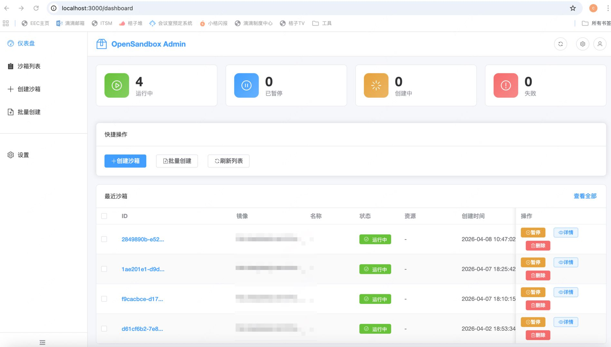
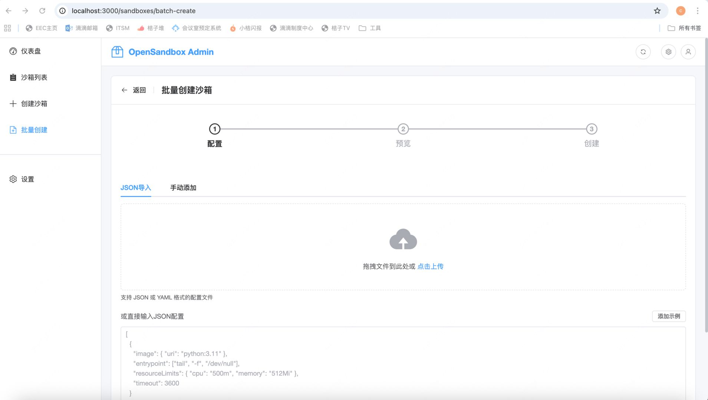
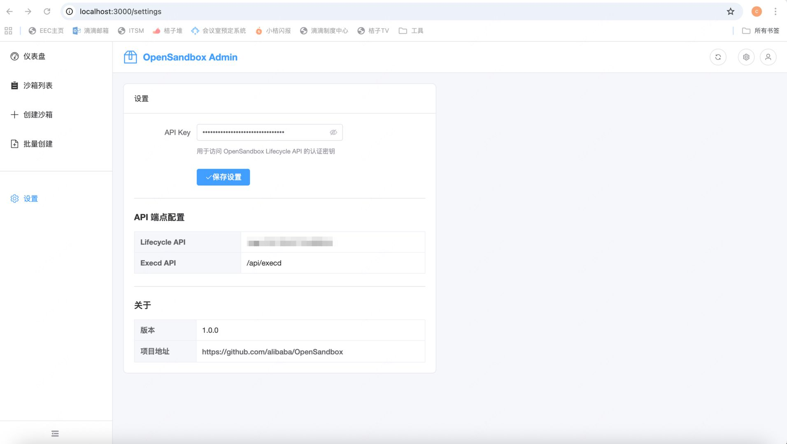

# OpenSandbox Admin

[English](#english) | [中文](#中文)

---

<a name="english"></a>
## English

### Overview

OpenSandbox Admin is a modern web-based management console for **OpenSandbox** - a lightweight, secure sandbox environment orchestration platform. This admin dashboard provides a comprehensive interface for managing containerized sandbox instances, monitoring resource usage, and controlling sandbox lifecycles.

The repository follows a frontend/backend split: a React SPA and a .NET 10 API that wraps the official [Alibaba.OpenSandbox](https://www.nuget.org/packages/Alibaba.OpenSandbox) SDK.

### Features

- **Dashboard Overview** - Real-time statistics of sandbox states (Running, Paused, Creating, Error)
- **Sandbox Management** - Create single or batch sandboxes from container images; pause, resume and delete instances; filter and search by state or metadata
- **Real-time Metrics** - Live CPU and memory monitoring streamed over SSE through the backend proxy
- **TTL Management** - Extend sandbox expiration with a datetime picker
- **Batch Operations** - Create multiple sandboxes via JSON import or manual input with progress tracking
- **Single-process Deployment** - Backend serves the built frontend with SPA fallback
- **Keycloak SSO** - Console login through Keycloak with separate sandbox and volume admin/viewer roles
- **Global Volume Governance** - Inventory PVCs across managed namespaces, register tenant ownership, detect label drift, report coverage, import existing volumes, and protect business volumes with Kubernetes admission policies

### Tech Stack

| Area | Technology |
|------|------------|
| Frontend | React 19, TypeScript, Vite, Ant Design 5, TanStack Query, ECharts, axios, dayjs |
| Backend | .NET 10, ASP.NET Core Minimal APIs, Alibaba.OpenSandbox 1.1.1, PostgreSQL 17, KubernetesClient |
| Tests | xUnit + WebApplicationFactory (backend), Vitest + Testing Library (frontend) |

### Repository Structure

```
├── backend/       # .NET 10 API (Contracts / Host / Infrastructure layers)
├── frontend/      # React 19 + Vite + Ant Design SPA
├── tests/         # xUnit test project
├── Dockerfile     # Multi-stage: node build -> dotnet publish -> runtime
└── docker-compose.yml
```

### Getting Started

Prerequisites: .NET SDK 10.0.401+, Node.js 20.19+ or 22.12+, Docker (for the local Keycloak stack)

Both terminals use the local Keycloak realm described below by default (`backend/appsettings.Development.json` and `frontend/.env.example`). Start Keycloak first:

```bash
docker compose --env-file .env.example up -d keycloak-postgres keycloak
```

For volume governance, also start PostgreSQL:

```bash
docker compose --env-file .env.example up -d postgres
```

The volume schema is only created by the startup migration, which requires
`VolumeManager:Enabled=true` and `MigrateOnStartup=true` (and a connection string).
Run the backend once with
`ConnectionStrings__VolumeManager="Host=localhost;Port=5432;Database=opensandbox;Username=opensandbox;Password=opensandbox"`
and `VolumeManager__Enabled=true` to create it; later runs may set it to `false` when
no Kubernetes API is available.

```bash
# Terminal 1 - backend (http://localhost:5080)
cd backend
dotnet run

# Terminal 2 - frontend dev server (http://localhost:3000, proxies /api to 5080)
cd frontend
npm install
cp .env.example .env.local   # local Keycloak realm for the Vite dev server
npm run dev
```

### Configuration

Backend settings in `backend/appsettings.json`:

```json
{
  "OpenSandbox": {
    "Domain": "https://sandbox.example.com",
    "ApiKey": "your-api-key"
  }
}
```

When running under Docker, compose overrides the same settings with the `OpenSandbox__Domain` / `OpenSandbox__ApiKey` environment variables (see `.env.example`).

Console authentication uses the `Auth` section and is required:

```json
{
  "Auth": {
    "Authority": "https://keycloak.example.com/realms/your-realm",
    "ClientId": "opensandbox-web",
    "RequireHttpsMetadata": true
  }
}
```

The backend refuses to start when `Auth:Authority` or `Auth:ClientId` is missing. `Auth:MetadataAddress` is optional: when set, OIDC discovery and JWKS are fetched from that URL while `Auth:Authority` remains the browser-visible issuer used for `iss` validation. Docker Compose uses this split (`http://localhost:8081/...` for the browser, `http://keycloak:8080/...` for the container); when it is unset, discovery is derived from `Authority`.

The Keycloak client is public, uses Standard Flow with PKCE S256, and must register the console origin (for example `http://localhost:3000/*` in development and `http://<console-host>:5080/*` in Docker) as a redirect URI and web origin. Register the same origin under **Valid post logout redirect URIs** (for example `http://localhost:3000/*` and `http://<console-host>:5080/*`): the console always sends `post_logout_redirect_uri`, and Keycloak shows an error page after logout when that URI is not registered. The bundled local realm (`deploy/keycloak/opensandbox-realm.json`) already registers ports 3000 and 5080 for all three lists.

Volume governance is configured through `ConnectionStrings:VolumeManager` and the
`VolumeManager` section:

```json
{
  "ConnectionStrings": {
    "VolumeManager": "Host=localhost;Port=5432;Database=opensandbox;Username=opensandbox;Password=..."
  },
  "VolumeManager": {
    "Enabled": true,
    "ScanInterval": "00:05:00",
    "ScanOnStartup": true,
    "ManagedNamespaceSelector": "opensandbox.io/volume-managed=true",
    "MaxConcurrentNamespaces": 4,
    "MigrateOnStartup": true
  }
}
```

The scanner needs a ServiceAccount with `namespaces get/list`,
`persistentvolumeclaims get/list/patch`, and `pods get/list`; apply
`deploy/volume-manager/rbac.yaml` and label managed namespaces with
`opensandbox.io/volume-managed=true`. The backend workload must also run as that
identity: set `serviceAccountName: opensandbox-volume-manager` on the backend
Deployment when running in-cluster, or set `VolumeManager:KubeConfigPath` when
running out-of-cluster. The `kubectl auth can-i --as=...` checks only validate the
binding, not the pod's identity. Deletion protection and rollout order are
documented in `docs/volume-manager-operations.md`; Keycloak setup is in
`deploy/volume-manager/keycloak-client.md`.

### API

All endpoints are prefixed with `/api/v1`:

| Endpoint | Method | Description |
|----------|--------|-------------|
| `/health` | GET | Liveness check |
| `/console/me` | GET | Current console identity and roles |
| `/sandboxes` | GET | List sandboxes (pagination, state/metadata filters) |
| `/sandboxes` | POST | Create a sandbox |
| `/sandboxes/{id}` | GET | Sandbox details |
| `/sandboxes/{id}` | DELETE | Delete a sandbox |
| `/sandboxes/{id}/pause` | POST | Pause a sandbox |
| `/sandboxes/{id}/resume` | POST | Resume a sandbox |
| `/sandboxes/{id}/renew-expiration` | POST | Extend expiration time |
| `/sandboxes/{id}/endpoints/{port}` | GET | Get sandbox endpoint for a port |
| `/sandboxes/{id}/metrics` | GET | Metrics snapshot |
| `/sandboxes/{id}/metrics/watch` | GET | Live metrics over SSE |
| `/volumes` | GET | Volume inventory with filters, search, sort and pagination |
| `/volumes/{namespace}/{claimName}` | GET | Volume ledger, observation and event timeline |
| `/volumes/report` | GET | Coverage, classification counts and violations |
| `/volumes/scan` | POST | Trigger an inventory scan |
| `/volumes/import` | POST | Import existing volumes (dry-run by default) |
| `/volume-tenants` | GET/POST | Tenant list and creation |
| `/volume-tenants/{id}` | PATCH | Update a tenant |
| `/volume-tenants/{id}/keys` | GET/POST | List or issue tenant API keys |
| `/tenant/volumes/register` | POST | Tenant registration (API key auth) |
| `/tenant/volumes` | GET | Tenant-scoped volume list (API key auth) |

Errors return a uniform body: `{ "code": "...", "message": "..." }`.

### Docker

```bash
# Local quick start: web (localhost:5080), opensandbox-server (127.0.0.1:8090) and Keycloak (localhost:8081).
cp .env.example .env
# Set KEYCLOAK_ADMIN_PASSWORD and KEYCLOAK_DB_PASSWORD in .env; optionally change the dev user password in deploy/keycloak/opensandbox-realm.json.
docker compose up -d --build
```

The console requires a Keycloak login. The bundled realm provides these local development users, all with password `change-me-local` (local development only: change the passwords before any shared deployment):

| User | Client role |
|------|-------------|
| `sandbox-admin` | `sandbox:admin` |
| `sandbox-viewer` | `sandbox:viewer` |
| `volume-admin` | `volume:admin` |
| `volume-viewer` | `volume:viewer` |

`volume-admin` and `volume-viewer` intentionally have no sandbox role, so they exercise the no-permission view.

- Open `http://localhost:5080` for the console. The Keycloak admin console is at `http://localhost:8081` (log in with `KEYCLOAK_ADMIN_USER` / `KEYCLOAK_ADMIN_PASSWORD` from `.env`).
- The realm in `deploy/keycloak/opensandbox-realm.json` is imported only on first start, when the Keycloak Postgres volume is empty. Editing the realm JSON does not re-import it; remove the volume to re-import it. The Keycloak admin bootstrap password is also applied only on first start. Warning: `docker compose down -v` destroys **all** compose volumes, including the Keycloak database.
- `opensandbox-web` reaches Keycloak over the compose network: `Auth__Authority` stays the browser-visible `http://localhost:8081/realms/opensandbox` while `Auth__MetadataAddress` defaults to `http://keycloak:8080/realms/opensandbox/.well-known/openid-configuration` for in-container discovery and JWKS. If you change `KEYCLOAK_PORT`, update `AUTH_AUTHORITY` to match.
- `opensandbox-web` has no startup dependency on Keycloak: the API starts even when Keycloak is down, and logins fail until Keycloak is ready.
- `opensandbox-web` reaches `opensandbox-server` over the compose network; the OpenSandbox defaults require no `.env` changes. Set `OPENSANDBOX_DOMAIN` / `OPENSANDBOX_API_KEY` only when connecting to an external OpenSandbox platform.
- Production must use its own realm, register the console origin as redirect URI, web origin and post logout redirect URI, and set `AUTH_REQUIRE_HTTPS_METADATA=true`. To use an external realm instead of the local stack, point `AUTH_AUTHORITY` (and, if discovery must use a different URL, `AUTH_METADATA_ADDRESS`) at it.
- `opensandbox-server` mounts the host's `/var/run/docker.sock` to create sandbox containers (inherent to the upstream design), so it can see and clean up expired sandbox containers labelled OpenSandbox on the host; port 8090 is bound to 127.0.0.1 only.
- Pre-pull the runtime images `opensandbox/execd:v1.1.0` and `opensandbox/egress:v1.1.7` before creating the first sandbox: a cold pull may exceed the backend's default 30s request timeout (raise OPENSANDBOX_REQUEST_TIMEOUT_SECONDS in .env).
- After editing the inline server configuration in `docker-compose.yml`, run `docker compose up -d --force-recreate opensandbox-server` for the change to take effect.
- The local realm registers the console redirect URIs, web origins and post logout redirect URIs for ports 3000 and 5080; when replacing it, register them before exposing port 5080. The API rejects anonymous requests even if the UI is bypassed.
- Docker Compose also starts PostgreSQL 17 (`postgres-data` volume). Set
  `POSTGRES_PASSWORD`, `AUTH_AUTHORITY`, and `VOLUME_MANAGER_ENABLED` in `.env`.
  The schema is migrated only while the module is enabled (`Enabled && MigrateOnStartup`),
  so start once with `VOLUME_MANAGER_ENABLED=true` (or run `dotnet ef database update` /
  a migration Job) before disabling scanning. Containers without Kubernetes API access
  may then set `VOLUME_MANAGER_ENABLED=false`; against a fresh, unmigrated database the
  volume endpoints return `503 dependency_unavailable`.

### Testing

```bash
dotnet test tests/OpenSandbox.Web.Tests
cd frontend && npm test && npm run lint
```

### Screenshots







### License

MIT License

---

<a name="中文"></a>
## 中文

### 项目简介

OpenSandbox Admin 是 **OpenSandbox** 的现代化 Web 管理控制台——一个轻量级、安全的沙箱环境编排平台。该管理面板提供完整的界面来管理容器化沙箱实例、监控资源使用情况以及控制沙箱生命周期。

仓库采用前后端分离结构：React 单页应用 + .NET 10 API（封装官方 [Alibaba.OpenSandbox](https://www.nuget.org/packages/Alibaba.OpenSandbox) SDK）。

### 功能特性

- **仪表盘概览** - 实时统计沙箱状态（运行中、已暂停、创建中、错误）
- **沙箱管理** - 从容器镜像创建单个或批量沙箱；暂停、恢复、删除实例；按状态或元数据过滤和搜索
- **实时监控** - CPU 与内存指标经后端代理以 SSE 推送，浏览器无需直连沙箱端点
- **TTL 管理** - 通过时间选择器延长沙箱过期时间
- **批量操作** - JSON 导入或手动输入批量创建，带进度显示
- **单进程部署** - 后端托管前端构建产物并提供 SPA fallback
- **Keycloak 单点登录** - 控制台通过 Keycloak 登录，沙箱与卷各自区分 admin/viewer 角色
- **全局卷治理** - 跨受管命名空间盘点 PVC、登记租户归属、检测标签漂移、统计覆盖率、回填存量卷，并用 Kubernetes 准入策略保护业务卷

### 技术栈

| 领域 | 技术 |
|------|------|
| 前端 | React 19、TypeScript、Vite、Ant Design 5、TanStack Query、ECharts、axios、dayjs |
| 后端 | .NET 10、ASP.NET Core Minimal API、Alibaba.OpenSandbox 1.1.1、PostgreSQL 17、KubernetesClient |
| 测试 | xUnit + WebApplicationFactory（后端）、Vitest + Testing Library（前端） |

### 仓库结构

```
├── backend/       # .NET 10 API（Contracts / Host / Infrastructure 分层）
├── frontend/      # React 19 + Vite + Ant Design 单页应用
├── tests/         # xUnit 测试项目
├── Dockerfile     # 多阶段构建：node 构建 -> dotnet 发布 -> 运行镜像
└── docker-compose.yml
```

### 快速开始

环境要求：.NET SDK 10.0.401+、Node.js 20.19+ 或 22.12+、Docker（用于本地 Keycloak 栈）

两个开发服务器默认使用下文的本地 Keycloak realm（`backend/appsettings.Development.json` 与 `frontend/.env.example`）。先启动 Keycloak：

```bash
docker compose --env-file .env.example up -d keycloak-postgres keycloak
```

使用卷治理时还需启动 PostgreSQL：

```bash
docker compose --env-file .env.example up -d postgres
```

卷治理的 schema 只由启动迁移创建，条件是 `VolumeManager:Enabled=true`、
`MigrateOnStartup=true` 且配置了连接串。先以
`ConnectionStrings__VolumeManager="Host=localhost;Port=5432;Database=opensandbox;Username=opensandbox;Password=opensandbox"`
与 `VolumeManager__Enabled=true` 运行一次后端完成建表；之后在没有 Kubernetes API 的
环境可改为 `false`。

```bash
# 终端 1 - 后端（http://localhost:5080）
cd backend
dotnet run

# 终端 2 - 前端开发服务器（http://localhost:3000，/api 代理到 5080）
cd frontend
npm install
cp .env.example .env.local   # Vite 开发服务器使用的本地 Keycloak realm/client
npm run dev
```

### 配置

后端配置位于 `backend/appsettings.json`：

```json
{
  "OpenSandbox": {
    "Domain": "https://sandbox.example.com",
    "ApiKey": "your-api-key"
  }
}
```

在 Docker 下运行时，compose 通过环境变量 `OpenSandbox__Domain` / `OpenSandbox__ApiKey` 覆盖同名配置（见 `.env.example`）。

控制台登录使用 `Auth` 配置，且为必填：

```json
{
  "Auth": {
    "Authority": "https://keycloak.example.com/realms/your-realm",
    "ClientId": "opensandbox-web",
    "RequireHttpsMetadata": true
  }
}
```

缺少 `Auth:Authority` 或 `Auth:ClientId` 时后端拒绝启动。`Auth:MetadataAddress` 为可选项：设置后 OIDC discovery 与 JWKS 从该地址获取，而 `Auth:Authority` 仍是浏览器可见的 issuer，用于 `iss` 校验。Docker Compose 即采用这种拆分（浏览器使用 `http://localhost:8081/...`，容器内使用 `http://keycloak:8080/...`）；留空时 discovery 由 `Authority` 推导。

Keycloak 客户端为公共客户端，启用 Standard Flow + PKCE S256，并需把控制台源（开发环境如 `http://localhost:3000/*`，Docker 环境如 `http://<控制台主机>:5080/*`）登记为 redirect URI 与 web origin，同时在 **Valid post logout redirect URIs** 中登记同一控制台源（如 `http://localhost:3000/*` 与 `http://<控制台主机>:5080/*`）。控制台注销时总会发送 `post_logout_redirect_uri`，未登记时注销后会落到 Keycloak 的错误页。仓库内置的本地 realm（`deploy/keycloak/opensandbox-realm.json`）已为 3000 与 5080 端口登记上述三类地址。

卷治理使用 `ConnectionStrings:VolumeManager` 与 `VolumeManager` 节：

```json
{
  "ConnectionStrings": {
    "VolumeManager": "Host=localhost;Port=5432;Database=opensandbox;Username=opensandbox;Password=..."
  },
  "VolumeManager": {
    "Enabled": true,
    "ScanInterval": "00:05:00",
    "ScanOnStartup": true,
    "ManagedNamespaceSelector": "opensandbox.io/volume-managed=true",
    "MaxConcurrentNamespaces": 4,
    "MigrateOnStartup": true
  }
}
```

扫描器需要 ServiceAccount 具备 `namespaces get/list`、
`persistentvolumeclaims get/list/patch`、`pods get/list`；先应用
`deploy/volume-manager/rbac.yaml`，再给受管命名空间打上
`opensandbox.io/volume-managed=true`。后端工作负载还必须以该 ServiceAccount 运行：
集群内部署时在 Deployment 上设置 `serviceAccountName: opensandbox-volume-manager`；
集群外运行时设置 `VolumeManager:KubeConfigPath`。`kubectl auth can-i --as=...` 只验证
绑定是否生效，不代表 Pod 的实际身份。删除保护与上线顺序见
`docs/volume-manager-operations.md`，Keycloak 配置见
`deploy/volume-manager/keycloak-client.md`。

### API

所有端点以 `/api/v1` 为前缀：

| 端点 | 方法 | 说明 |
|------|------|------|
| `/health` | GET | 存活检查 |
| `/console/me` | GET | 当前控制台身份与角色 |
| `/sandboxes` | GET | 沙箱列表（分页、状态/元数据过滤） |
| `/sandboxes` | POST | 创建沙箱 |
| `/sandboxes/{id}` | GET | 沙箱详情 |
| `/sandboxes/{id}` | DELETE | 删除沙箱 |
| `/sandboxes/{id}/pause` | POST | 暂停沙箱 |
| `/sandboxes/{id}/resume` | POST | 恢复沙箱 |
| `/sandboxes/{id}/renew-expiration` | POST | 延长过期时间 |
| `/sandboxes/{id}/endpoints/{port}` | GET | 获取沙箱端口端点 |
| `/sandboxes/{id}/metrics` | GET | 指标快照 |
| `/sandboxes/{id}/metrics/watch` | GET | SSE 实时指标 |
| `/volumes` | GET | 卷列表（筛选、搜索、排序、分页） |
| `/volumes/{namespace}/{claimName}` | GET | 台账、观测与事件时间线 |
| `/volumes/report` | GET | 覆盖率、分类统计与违规 |
| `/volumes/scan` | POST | 触发库存扫描 |
| `/volumes/import` | POST | 回填导入（默认 dry-run） |
| `/volume-tenants` | GET/POST | 租户列表与新建 |
| `/volume-tenants/{id}` | PATCH | 修改租户 |
| `/volume-tenants/{id}/keys` | GET/POST | 查看或签发租户 Key |
| `/tenant/volumes/register` | POST | 租户注册（API Key 认证） |
| `/tenant/volumes` | GET | 租户视角卷列表（API Key 认证） |

错误响应统一为：`{ "code": "...", "message": "..." }`。

### Docker

```bash
# 本地快速启动：web（localhost:5080）、opensandbox-server（127.0.0.1:8090）与 Keycloak（localhost:8081）。
cp .env.example .env
# 在 .env 中设置 KEYCLOAK_ADMIN_PASSWORD 与 KEYCLOAK_DB_PASSWORD；可按需修改 deploy/keycloak/opensandbox-realm.json 中的开发用户密码。
docker compose up -d --build
```

控制台要求 Keycloak 登录。内置 realm 提供以下本地开发用户，密码均为 `change-me-local`（仅用于本地开发：共享部署前必须修改密码）：

| 用户 | 客户端角色 |
|------|-----------|
| `sandbox-admin` | `sandbox:admin` |
| `sandbox-viewer` | `sandbox:viewer` |
| `volume-admin` | `volume:admin` |
| `volume-viewer` | `volume:viewer` |

`volume-admin` 与 `volume-viewer` 有意不授予 sandbox 角色，用于验证无权限页面。

- 控制台地址为 `http://localhost:5080`；Keycloak 管理控制台为 `http://localhost:8081`（使用 `.env` 中的 `KEYCLOAK_ADMIN_USER` / `KEYCLOAK_ADMIN_PASSWORD` 登录）。
- `deploy/keycloak/opensandbox-realm.json` 中的 realm 仅在首次启动、Keycloak Postgres 卷为空时导入。之后修改 realm JSON 不会重新导入，需删除该卷后重启。Keycloak 管理员引导密码同样只在首次启动时生效。警告：`docker compose down -v` 会销毁**所有** compose 卷，包括 Keycloak 数据库。
- `opensandbox-web` 通过 compose 网络访问 Keycloak：`Auth__Authority` 保持浏览器可见的 `http://localhost:8081/realms/opensandbox`，`Auth__MetadataAddress` 默认使用 `http://keycloak:8080/realms/opensandbox/.well-known/openid-configuration` 进行容器内 discovery/JWKS。若修改 `KEYCLOAK_PORT`，需同步修改 `AUTH_AUTHORITY`。
- `opensandbox-web` 启动时不依赖 Keycloak：即使 Keycloak 未就绪，API 也能启动，登录会在 Keycloak 就绪后恢复。
- `opensandbox-web` 通过 compose 网络访问 `opensandbox-server`，OpenSandbox 相关默认无需修改 `.env`；仅当连接外部 OpenSandbox 平台时才设置 `OPENSANDBOX_DOMAIN` / `OPENSANDBOX_API_KEY`。
- 生产环境必须使用自己的 realm，把控制台源同时登记为 redirect URI、web origin 与 post logout redirect URI，并设置 `AUTH_REQUIRE_HTTPS_METADATA=true`。如需改用外部 realm，将 `AUTH_AUTHORITY`（以及 discovery 使用不同地址时的 `AUTH_METADATA_ADDRESS`）指向该 realm。
- `opensandbox-server` 挂载宿主机 `/var/run/docker.sock` 以创建沙箱容器（上游设计的固有行为），因此它能看到并清理宿主机上带 OpenSandbox 标签的过期沙箱容器；8090 仅绑定 127.0.0.1。
- 首次创建沙箱前建议预拉运行时镜像 `opensandbox/execd:v1.1.0` 与 `opensandbox/egress:v1.1.7`：冷拉可能超过后端默认 30s 请求超时（可在 .env 中调大 OPENSANDBOX_REQUEST_TIMEOUT_SECONDS）。
- 修改 `docker-compose.yml` 内联 server 配置后，需 `docker compose up -d --force-recreate opensandbox-server` 才会生效。
- 本地 realm 已为 3000 与 5080 端口登记控制台 redirect URI、web origin 与 post logout redirect URI；替换 realm 时，对外开放 5080 前需重新登记。即使绕过界面，API 也会拒绝匿名请求。
- Docker Compose 同时启动 PostgreSQL 17（`postgres-data` 持久卷）。在 `.env` 中设置
  `POSTGRES_PASSWORD`、`AUTH_AUTHORITY`、`VOLUME_MANAGER_ENABLED`。schema 只在模块启用时
  迁移（`Enabled && MigrateOnStartup`），因此需先以 `VOLUME_MANAGER_ENABLED=true` 启动一次
  （或执行 `dotnet ef database update` / 迁移 Job），之后才可关闭扫描。容器无法访问
  Kubernetes API 时再把 `VOLUME_MANAGER_ENABLED` 设为 `false`；面对未迁移的全新数据库，
  卷接口会返回 `503 dependency_unavailable`。

### 测试

```bash
dotnet test tests/OpenSandbox.Web.Tests
cd frontend && npm test && npm run lint
```

### 截图


### 许可证

MIT License
